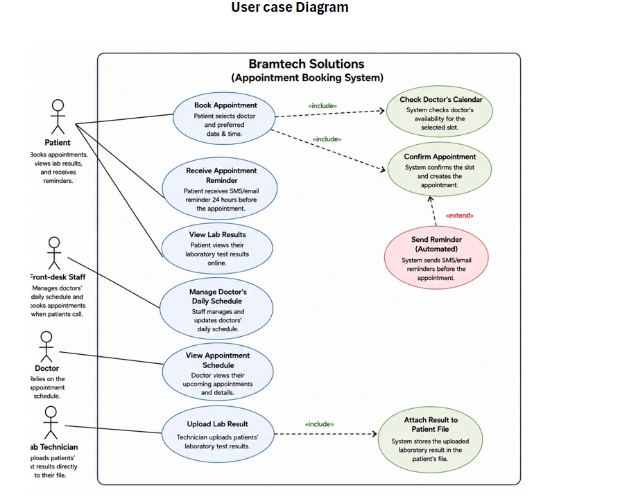

# CarePoint Clinics: Requirements Analysis

*An individual business analysis mini project using a simulated case.*

## The problem
CarePoint runs six clinics and uses a system called Bramtech Solutions for bookings, SMS reminders and lab results. Three problems had appeared:
- 140+ double-bookings in one quarter, because front-desk and app bookings did not sync in real time
- No-shows rose from 12% to 29%, and 1 in 4 patients said they never received their SMS reminder
- 9 lab results were attached to the wrong patient's file, and one was found by the patient, not by staff

## What I did
1. **Stakeholder register:** identified 8 stakeholder groups and ranked each by interest and influence
2. **Elicitation:** chose document analysis for the booking sync failures and a patient survey for the lab result errors, and explained why each fits, then wrote the survey
3. **Requirements trace:** followed each problem from business requirement to stakeholder, functional and non-functional requirements
4. **Use case diagram:** showed how users interact with the system

## Example from the requirements trace
| Problem | Business requirement | Functional requirement | Non-functional requirement |
|---|---|---|---|
| 140+ double-bookings | Only one booking can hold a slot at a time | Lock a time slot instantly when the app or front desk selects it | Lock takes effect within 2 seconds, with 99.9% reliability, across all 6 clinics |

## Use case diagram

## Files
- `CarePoint_Requirements_Analysis.xlsx`: full work (stakeholder register, elicitation, requirements trace)
- `use_case_diagram.png`: use case diagram

## Tools
Microsoft Excel
